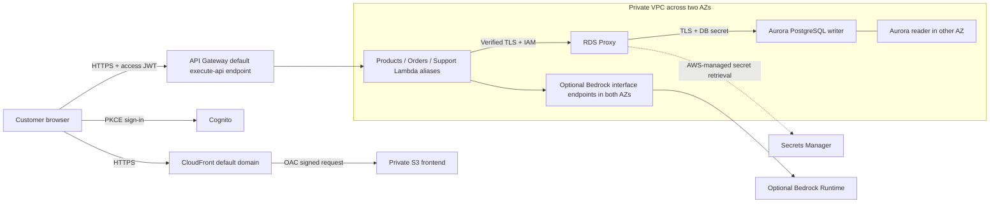

# Retail application architecture

The POC modernizes one representative retail application to reduce guest OS maintenance and exposure to the retiring virtualization platform. It demonstrates a repeatable delivery pattern for suitable applications while the fleet migration follows a separate wave plan. Its target is resource and AZ resilience in `us-west-2`; deployment, failover, latency and cost outcomes remain unverified until recorded in [acceptance-status.md](acceptance-status.md).

The editable [architecture.drawio](architecture.drawio) uses diagrams.net's AWS4 icon library, with service and resource stencil names checked against the [JGraph palette source](https://github.com/jgraph/drawio/blob/dev/src/main/webapp/js/diagramly/sidebar/Sidebar-AWS4.js). Open it in diagrams.net to inspect and export; XML structure was validated, but an exported, visually reviewed diagram has not been claimed.

| Decision | Implemented design intent | Business connection and tradeoff |
| --- | --- | --- |
| Globally delivered frontend | Private S3, Block Public Access, OAC restricted to this CloudFront distribution, HTTPS redirect and default managed certificate | Removes web VMs and their patching; edge caching reduces remote static-asset latency. Dynamic API round trips remain regional. |
| Direct HTTPS API | Browser calls default `execute-api.us-west-2.amazonaws.com` URL; exact CloudFront origin CORS and required auth headers | Avoids a second CloudFront API behavior and reduces delivery complexity. API responses carry `Cache-Control: no-store`; the frontend must not persist private response bodies in a shared cache. |
| Three Lambda services | Products, Orders and Support have separate roles, versions, aliases and bounded concurrency | Smaller deployment units and no guest OS patching accelerate future modernization. Long-running or tightly coupled fleet workloads may need EC2 or containers first. |
| Cognito authentication | Hosted UI authorization code with PKCE; HTTP API JWT authorizer on private routes; backend verifies subject ownership | Reuses managed identity and avoids per-VM identity code. CORS is a browser control, not authorization; cross-user queries must fail even with a valid token. |
| Two-AZ PostgreSQL Serverless v2 | Two private `db.serverless` instances, writer and promotable reader; explicit supported engine version; bounded ACUs | Managed engine/storage maintenance and failover reduce operations. Minimum capacity and replica cost persist during idle periods. This is a new engine, not an in-place conversion of the reference MySQL DB. |
| RDS Proxy | TLS required, IAM client authentication, Secrets Manager credentials to DB, default writer endpoint | Pools bursty Lambda connections and reduces failover coupling. Adds a fixed cost floor; reads through this endpoint reach the writer, not a load-balanced reader fleet. |
| Endpoint-only egress | Temporary two-AZ Secrets Manager endpoints serve bootstrap; remove them after bootstrap. Optional two-AZ Bedrock Runtime endpoints serve Support. No NAT or public subnets. | Normal functions sign IAM tokens locally; Proxy retrieves secrets through its service integration. Omitting unused endpoints reduces fixed cost. More endpoint services can exceed NAT cost; external APIs need a separately designed egress path. |
| Optional contextual AI | Authorize order/product facts in a short read, release DB before Converse, validate generated assistance, render DB facts separately; explicit escalation only | Useful conversation without occupying pooled DB connections during model latency. Factual fallback preserves support. Inference can repeat during concurrent retries, but persistent response receipts prevent duplicate tickets. |
| Reproducible Terraform | Inputs, pinned providers, separately packaged functions and reviewed plans | Standardizes future workloads and reduces manual migration effort. Does not replicate VM disks or automatically refactor arbitrary applications. |

Network flow is Lambda SG → Proxy SG TCP/5432 → Aurora SG TCP/5432. The DB has no public IP or default internet route, and its ingress source is the Proxy SG. Lambda has no inbound application rule and reaches configured AWS service endpoints only on TCP/443. Lambda VPC configuration includes application subnets in two AZs; AWS runs the managed execution environment. RDS Proxy and enabled interface endpoints have subnet coverage in both AZs. With AI and bootstrap disabled, no application-called AWS SDK service needs an interface endpoint. No single NAT gateway is on a critical path.

TLS verification is explicit. The client uses an SSL context with certificate and hostname checks, TLS 1.2 or later, standard trusted roots for RDS Proxy's AWS-managed ACM certificate, and the packaged AWS RDS regional CA bundle. Aurora additionally has `rds.force_ssl = 1`; Proxy has `require_tls = true`. An RDS-only CA bundle is insufficient as the sole trust store for a Proxy certificate. No ACM certificate resource or custom domain is provisioned. See [RDS Proxy TLS](https://docs.aws.amazon.com/AmazonRDS/latest/AuroraUserGuide/rds-proxy.howitworks.html) and [Aurora PostgreSQL SSL](https://docs.aws.amazon.com/AmazonRDS/latest/AuroraUserGuide/AuroraPostgreSQL.Security.html).

Database authentication is standard Proxy IAM authentication: Lambda generates a short-lived IAM token locally for its Proxy connection, and Proxy obtains the corresponding DB password from Secrets Manager through the AWS-managed service integration. That service retrieval does not use a normal Lambda function's VPC internet route or endpoint. Ordinary functions use `retail_app`; they cannot read the managed master secret or assume the bootstrap role. A temporary separately authorized bootstrap function initializes schema and the app role, then is removed with its Secrets Manager endpoints. Secrets are never Terraform string values or outputs. This POC needs a separately tested application-password rotation procedure before production use.

Orders use DB-derived prices, row-level inventory locks in deterministic order, one database transaction, and an idempotency key scoped to the authenticated customer and request payload. A repeated key cannot create a second order. No payment processing or sensitive payment data is included. Backward-compatible schema changes and alias-based releases avoid replacing Aurora for an application update.

Support uses actual Converse-generated prose for conversation and basic product troubleshooting. The model has no SQL/tool access and cannot authorize an order or create a ticket. Generated output is constrained and checked; controlled order/product facts come only from DB fields rendered separately with `facts_as_of`. Invalid or unavailable model output falls back safely. These checks are defense in depth, not a formal proof of every possible model statement; adversarial live acceptance is required before production claims. A short final transaction serializes customer/key retries, rechecks the immutable response receipt, and commits that receipt plus any explicitly requested ticket together. Normal conversations return `ticket: null`. No DB transaction remains open during inference; receipts are snapshots, so a retry can be older than the latest order state.

Aurora Serverless v2 + Proxy is a supported architecture generally, but the competition account's actual engine versions, classes, quotas, IAM boundaries and Bedrock models must be checked. See [Aurora regional compatibility](https://docs.aws.amazon.com/AmazonRDS/latest/AuroraUserGuide/Concepts.Aurora_Fea_Regions_DB-eng.Feature.ServerlessV2.html) and [Bedrock interface endpoints](https://docs.aws.amazon.com/bedrock/latest/userguide/vpc-interface-endpoints.html). Support is designed to work without AI; a failure of Cognito, Aurora or the regional API still affects relevant customer operations. Multi-region DR, automated CodeDeploy rollout, WAF, SQS processing and measured RTO/RPO are future work, not deployed features.
